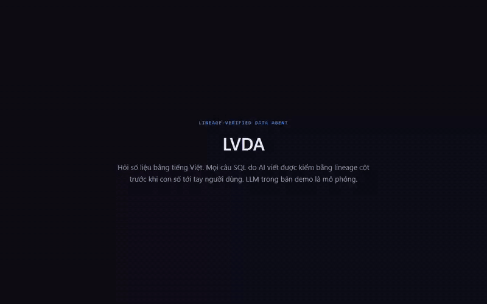

# LVDA — Lineage-Verified Data Agent (MVP)

A data agent that answers questions about a warehouse in Vietnamese and **checks every number against column lineage before it answers**.



Full demo (1 min 50 s, scenarios KB-1 to KB-5): [docs/media/demo.mp4](docs/media/demo.mp4) — green answer, wrong
measure fixed automatically, fan-out join caught, question without a certified metric answered yellow, SQL checked
through MCP.

Text-to-SQL is usually wrong in ways that still run: the wrong measure column, a missing business filter, a join that
multiplies rows, a count over the wrong key. LVDA parses the SQL the model wrote, extracts a *lineage fingerprint*
(measures, filters, joins, time column, grain), compares it with the certified metric definition and gives a
**green / yellow / red** verdict with evidence. Red answers go through up to two self-fix rounds; if still red the
number is held back and queued for review. Published answers are also reconciled against the canonical SQL.
Questions no certified metric can express ("sellers in SP with more than 10 orders") get their own SQL, checked
with the general rules only, and are capped at yellow and sent to a data engineer for review.

> **MVP status.** The data is a synthetic dataset with the Olist schema (a CSV loader for the real Kaggle files is
> included). Everything that needs an LLM — SQL writing, fixes, answer wording, the LLM-as-judge baseline — runs on a
> **mock model** with deliberately injected mistakes, behind the same interface a real OpenAI-compatible model would
> use. The verifier, self-fix loop, reconciliation, permissions and the evaluation harness are real.

## Results

| | Result |
|---|---|
| Broken SQL caught | **142/142** (60 injected mutations + 82 first attempts from the agent log) |
| False alarms | **0/60** correct SQL |
| Check latency | p50 ≈ 12 ms, p95 ≈ 17 ms, no LLM call |
| vs. LLM-as-judge (mock) | judge recall 60–65%, false alarms 8–24%, same verdict across 3 runs only 48–75% of the time |
| Agent, mock-small | 31% correct without checks → **91%** with verifier + self-fix; silent wrong answers 80 → 1 |

The error sets are generated by this project, so they measure *known* error classes, not the unknown failure modes of
a real model. Method, full tables and limitations: [EVAL.md](EVAL.md). Architecture: [ARCHITECTURE.md](ARCHITECTURE.md).

## Run

**Option 1 — everything in Docker** (Docker Desktop):

```powershell
docker compose up -d --build      # db :5460, api :8020, web :5179 (seeds data on first start), sample source :5461
docker compose --profile mysql up -d   # optional: sample MySQL source on :3307
```

**Option 2 — dev** (Python 3.11, Node 20+):

```powershell
docker compose up -d --wait db
cd backend
python -m venv .venv
.\.venv\Scripts\python -m pip install -e ".[mcp,dev]"
.\.venv\Scripts\python -m lvda.seed.bootstrap            # --reset to start over, --olist-dir <path> for the real CSVs, --no-enterprise to skip the 500-table warehouse
.\.venv\Scripts\python -m uvicorn lvda.main:app --port 8020
cd ..\frontend; npm install; npm run dev
```

After the first install, `.\scripts\dev.ps1` starts all three. With `make`: `make up`, `make seed`, `make api`, `make web`.

Open http://localhost:5179, password `lvda1234`:

| Email | Role |
|---|---|
| `engineer@lvda.dev` | engineer: define and certify metrics, review, manage members, share links, settings |
| `analyst@lvda.dev` | viewer: ask, check SQL, browse metrics and data (PII columns masked) |
| `guest@lvda.dev` | no access yet: use to try a share link |

Configuration is via environment variables, see [.env.example](.env.example). The UI is in Vietnamese.

## Screens

Four nav items. Viewers see the first two; engineers see all four.

| Nav item | What it does |
|---|---|
| **Ask & check** | One box for questions and SQL (typing `SELECT`/`WITH` switches to SQL check). Before sending, the box shows how the question was understood and offers other metrics when it is ambiguous. Every answer is a card: number, verdict, reconciliation with canonical SQL, assumptions, attempts, and four tabs — **Lineage** (raw → mart → operations → result graph, bad nodes in red, missing filters dashed), **Findings**, **SQL** (diff between fix rounds), **Trace** (steps, tokens, cost, ms, request_id). The bar above the feed opens **Agent configuration**, a panel over the session: **Metrics** (YAML definitions, lineage graph, certify / deprecate, version diff, "needs re-certification", YAML export, MetricFlow import; read-only for viewers) and, for engineers, **Rules, model & verified queries** (enable and re-grade each rule, choose the model, limits). Clicking the metric name on an answer opens its definition. |
| **Data** | A catalog built for hundreds of tables. The start page never lists every table: it offers recently viewed tables, the tables the agent uses most, tables behind certified metrics, and business domains (tables per layer, PII, descriptions awaiting review, deprecated). Search ranks tables and columns by name, description (diacritics optional) and how often the agent used them. A table opens a lineage canvas (React Flow): each table is a node with its columns inside, one lane per layer (source → staging → mart → metric), at most 14 neighbours per table before the rest fold into "show all". Clicking a column pulls its whole path into view, lights it, and opens a side panel with a **trust block** (questions that used it, green share, held answers, mistakes the verifier caught, certified metrics with who and when) and an **impact list** (downstream tables per layer, columns, metrics, verified queries, past questions). Engineers edit and approve AI-drafted descriptions there. "Reload warehouse" re-crawls the views and flags metrics whose lineage changed. |
| **Evaluation** | A dashboard. Six **system cards** are locked (move, resize, collapse only; never edited or deleted). **Edit dashboard** adds user cards: an agent asks up to three questions (goal, audience, cadence, plus an optional focus; "skip, use defaults"), then streams each step it takes (read answers, plan, check every card against the metric store and the verifier, with the reason a card was dropped and a request_id) and drops the result into a **tray**. The tray is a right-hand column on wide screens and a drawer below 1280 px. Cards move from the tray by drag and drop or an "Add" button; arrows, size, collapse, edit, "back to tray" and delete work without dragging. Undo (Ctrl+Z), Cancel and Save; nothing is stored until Save. A user card never holds SQL: it stores parameters of a certified metric (dimension, period, chart, top N), the server rebuilds the canonical SQL and runs it through the verifier on every render, and the card shows its verdict, metric version and check time. Draft, stale or deprecated metrics are refused. The system cards: a **Needs review** card (yellow/red answers, reconciliation mismatches, answers flagged wrong; opens the review queue, where approving turns an answer into a verified query), 30-day green share, held answers, self-fix rate, user flags, latency and cost, most-asked metrics with their green share, and the mistakes the agent makes on its first draft. The **detailed report** keeps the technical results: verifier per rule (click a rule to list its cases) and per error source, judge comparison, agent ablation per model and config. Trace lookup by request_id sits in the header. |
| **Sharing & audit** | Per-database roles, share links with expiry / use limits / revoke (links can never certify), and the append-only audit log filtered by group: access, metrics, reviews, settings and data. |

Old paths still work: `/reviews` opens the review queue, `/members` and `/audit` open Sharing & audit, `/metrics` and `/settings` open the configuration panel.

## Two databases: Olist and a 500-table warehouse

Bootstrap also builds **"Bán lẻ đa kênh · 500 bảng"**, a synthetic retail warehouse to exercise the catalog at enterprise
scale: 10 business domains × (20 source tables + 16 staging views + 14 mart views), 237 declared joins, 225 PII columns,
a deliberately duplicated key, 20 deprecated tables, cross-domain joins (orders → customer accounts, payments → orders).
Nothing about its lineage is written down: the catalog reads the view definitions from Postgres (`pg_views`), parses
them with sqlglot and stores a snapshot, like a metadata crawler would.

| Measure (500 tables, 4,081 columns, local Docker) | Result |
|---|---|
| Crawl + parse every view into column lineage | 1.4 s (63 s before reusing one sqlglot `MappingSchema`) |
| Views whose lineage parsed | 300 / 300 |
| Search across all tables and columns | ~100 ms, a few KB per page |
| Lineage neighbourhood, table detail with trust and impact | ~60 ms and ~140 ms, under 20 KB |

This database is catalog-only: it has no certified metrics, so the agent does not answer questions on it and the Ask
tab says so. The verifier and agent still run on Olist.

## Connecting your own database (incremental sync)

**Data sources** (a fifth nav item, engineers only) lists every database the engineer manages.
- **List.** Sources are grouped by environment (prod / staging / dev), with built-in databases in their own group. Each row shows tables, rows and last sync. Search covers name, host and database, and filters pick out **errors**, **copying** and **stale data** (last successful sync older than twice the schedule). The nav item carries a badge with the number of failing sources.
- **Detail.** The detail panel has three tabs: **Tables** (rows, cursor, watermark, drift), **Sync history** and **Settings** (name, environment, schedule, lookback, pause, password, disconnect). Below 1280 px the detail opens as a drawer.

**Connect database** is a four-step page:
1. **Source.**
2. **Check.** Four checks run in order: network (port reachable), authentication, read-only role, schema readable. The first failure stops the rest, so the user sees exactly what to fix.
3. **Pick tables.** Name, environment (guessed from the host), schedule and the table picker.
4. **First copy.** Tables done, rows copied, estimated time left from the measured speed, and a progress bar per table. Totals are database estimates, shown as "~", until each table finishes.

Completed steps show a summary and an Edit link. The copy runs in the background, so the page can be closed.

- **Entering the connection.** Paste a connection string (`postgresql://`, `mysql://`, with a driver suffix, or JDBC with `?user=&password=`) and it is split into host / port / database / user / password; extra parameters such as `sslmode` are kept. The fields can also be filled by hand.
- **Checking.** The connection is checked automatically once host, database and user are filled. Errors point at the field that caused them: wrong password, unknown host, missing database, missing schema.
- **Defaults.** Every readable table is selected, with its suggested cursor and an hourly sync. One line sums it up ("7 tables · 4 incremental · 3 full refresh"), and the form only mentions tables that need a decision. The table picker (search, "needs attention" filter, select by filter) stays folded.
- **After Connect.** Connect takes you straight to the Data tab. Progress shows on the sync bar, each table appears as soon as it is copied (the catalog is re-crawled at most every 5 s during a run), and a toast reports the result.
- **Managing a source later.** From the sync drawer you can add or remove tables (a removed table's copy is dropped) and change cursors (that table is recopied). You can also update the password (connection and read-only rights are checked again before saving) and pause or resume the schedule. **Disconnect** (type the database name to confirm) removes the database from LVDA with its copies, history and members; the source is untouched.

Under the form, it works in four steps:

1. **Connect with a read-only role.** Paste a connection string. LVDA checks the role before accepting it:
   - **PostgreSQL**: the role must not be superuser, replication, CREATEROLE or CREATEDB, and must have no CREATE on the database or schema and no INSERT/UPDATE/DELETE/TRUNCATE on any table.
   - **MySQL**: `SHOW GRANTS` may only contain SELECT / SHOW VIEW.

   A role with write rights is rejected, and the screen shows the SQL to create a read-only one. The session itself also runs read-only. The connection string is encrypted with Fernet (`LVDA_SECRET_KEY`) and is never returned by the API.
2. **Pick tables.** Each table has a primary key and a cursor column; `updated_at` is suggested automatically. An increasing id is offered too, with a warning that it is only correct for append-only tables.
3. **Copy into LVDA.** Data is copied into a schema `src_<id>` inside LVDA's Postgres.
   - **First run and full refresh** use `COPY`: 158k rows in about 8 s.
   - **Later runs are incremental.** Each run reads only rows with `cursor >= last watermark − lookback` (5 minutes by default, so transactions that commit late are not missed). It pages by `(cursor, key)` and upserts by key. Unchanged rows that are read again are not rewritten or counted.
   - **Tables without a cursor** are refreshed in full each run. A table without a key is limited to 200,000 rows.
4. **Keep the catalog in sync.** After each run the catalog is crawled again, so the Data tab shows the synced tables:
   - grain from primary keys;
   - joins from foreign keys;
   - descriptions from source comments.

The run is recorded with per-table read / inserted / updated counts and the watermark before and after. Schedules are off, 15 min, hourly or daily, run by a background thread in the API (`LVDA_SCHEDULER=0` disables it). If a column or key changes at the source, the copy is rebuilt.

**Limits:** deletes at the source are not seen by incremental sync. LVDA compares row counts after every run and flags any table whose copy has more rows than the source; **Full refresh** fixes it. Rows whose cursor is NULL only arrive on a full refresh. Change data capture from the WAL/binlog would remove both limits, but it needs replication privileges and extra infrastructure (Debezium/Kafka), so it is out of scope for the MVP. A synced database is catalog-only until certified metrics are defined for it.

**Try it locally.** `docker compose up` also starts a sample shop on Postgres (`demo-pg`, :5461). `--profile mysql` adds the same shop on MySQL 8.4 (:3307). Both have a read-only user `lvda_ro`, and the connect screen has buttons for them. To create changes at the source (new orders, status changes, a price change, new events and one deleted order), run:

```powershell
docker compose exec api python -m lvda.demo_source            # --kind mysql for the MySQL sample
```

## CLI and MCP

```powershell
lvda verify --sql "SELECT COUNT(o.order_id) FROM mart.fct_orders o" --metric order_count   # exit 1 on red/blocked

# MCP: verify_sql, explain_sql_lineage, list_metrics, get_metric_definition, run_certified_metric
claude mcp add lvda -- D:\CODE\LVDA\backend\.venv\Scripts\python D:\CODE\LVDA\backend\mcp_server.py   # stdio
python backend\mcp_server.py --http                                                                  # http://127.0.0.1:8021/mcp
```

## Tests and evaluation

```powershell
make check     # ruff + mypy (strict on the verifier) + 278 tests with the 80% verifier coverage gate
make eval      # reproduces every number in EVAL.md; reports in backend/eval/results/*.md|json
.\scripts\eval.ps1          # same as make eval, for Windows without make
```

CI (`.github/workflows/ci.yml`): gitleaks secret scan → ruff → mypy → bootstrap → pytest with coverage → evaluation
(report uploaded as an artifact) → frontend build.

## Plugging in a real LLM

`lvda/llm.py` already has an OpenAI-compatible client (OpenRouter, Ollama, vLLM). Set `LVDA_LLM_PROVIDER=openai`,
`LVDA_LLM_BASE_URL`, `LVDA_LLM_API_KEY`, `LVDA_LLM_MODEL`; prompts, structured output with one schema retry, response
caching and cost tracking stay the same. The client is untested against a live endpoint.

The parser and lineage graph ideas grew out of the team project P-116 Lineage AI (VinUni AI20K); LVDA reimplements them.
